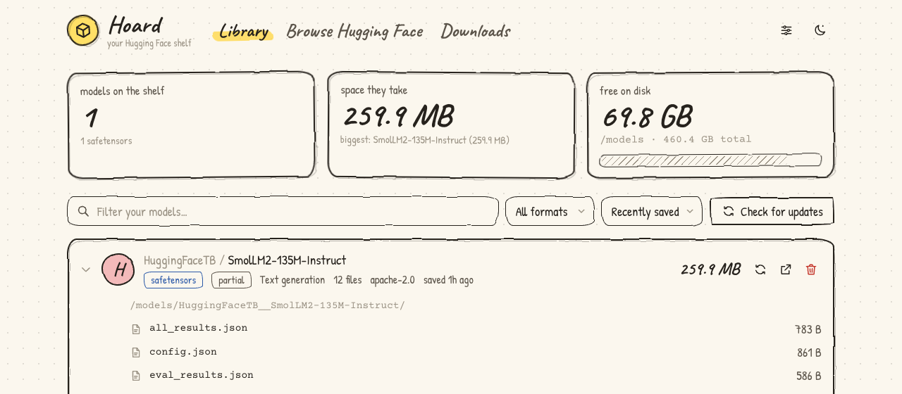

# Hoard

**A hand-drawn, self-hosted shelf for your Hugging Face models.**

Hoard runs in Docker on your home server or NAS. Search Hugging Face, pick exactly the files you want, and Hoard saves them as plain folders on your disk, ready for transformers, llama.cpp, Ollama or LM Studio, even offline or after a model disappears from the Hub.



- **Pick only the files you need.** A GGUF repo can hold 40 GB of quantizations when you want one 2 GB file. Hoard preselects a sensible one (Q4_K_M) and shows the total before you download.
- **Keep track of it all.** Size, format, license and revision of every model, update checks, and free disk space.
- **Use it from any device.** It's a web page, so it works from a phone, with no SSH needed.
- **Plain files.** Normal folders with the repo's own file names, not a hash-named cache.

<p>
  
  
</p>

## Quick start

You need a Linux machine with Docker and Docker Compose.

```bash
git clone https://github.com/Mr-Sunglasses/hoard.git && cd hoard

sudo mkdir -p /srv/models && sudo chown $(id -u):$(id -g) /srv/models
mkdir -p config && chmod 700 config

cp .env.example .env    # set PUID/PGID (`id -u`, `id -g`) and APP_PASSWORD
docker compose up -d --build
```

Open `http://<server-ip>:8080`. With `APP_PASSWORD` set, log in with any username and that password.

## Configuration

| Setting | Default | What it does |
|---|---|---|
| `APP_PASSWORD` | empty (no login) | Password for the UI and API. Recommended. |
| `HF_TOKEN` | empty | Hugging Face token for gated or private models. You can also add one in the UI; this one wins if both are set. |
| `PUID` / `PGID` | `1000` | The user the container runs as, so files belong to you, not root. |
| `/models` volume | `/srv/models` | Where models are saved. Can be a share or an external drive. |
| `/config` volume | `./config` | The token saved from the UI. Keep it out of any shared folder. |
| Port | `8080` | Change the left side in `docker-compose.yml` (e.g. `"9000:8080"`). |

The first three go in `.env`; the volumes and port are in `docker-compose.yml`.

## Using Hoard

**Browse.** Trending models load right away. Search, filter by task, or paste a repo id like `Qwen/Qwen2.5-7B-Instruct`. Models you already have are tagged *on your shelf*.

**Pick files.** Click a model to see its weights and configs. Choose a preset (everything, safetensors + configs, one GGUF quantization, configs only) or type a pattern like `*Q5_K_M*`. The footer shows the total size and the free space on disk.

**Download.** The Downloads tab shows progress, speed and time left. **Stop** keeps the partial files, and **Resume** continues from there. Progress moves in steps because data is written in chunks.

**Library.** Click a row to see its files. ↻ checks for a newer revision, and **Update** fetches it with the same file selection. Folders you copy in by hand show up too, tagged *added by hand*.

**Gated models** (Llama, Gemma…) need a token:

1. Accept the model's terms on its Hugging Face page.
2. Create a **Read** token at <https://huggingface.co/settings/tokens>.
3. In Hoard, open settings (the sliders icon, top right), paste the token and click **Check & save**.

Press `/` to jump to the search box and `Esc` to close panels. The sun/moon icon switches between the paper and chalkboard themes.

## Your files

Each repo gets one folder named `<org>__<model>`:

```
/srv/models/
├── bartowski__Llama-3.2-3B-Instruct-GGUF/
│   ├── Llama-3.2-3B-Instruct-Q4_K_M.gguf
│   ├── .hoard.json      ← Hoard's notes: repo, commit, file selection
│   └── .cache/          ← resume data
└── HuggingFaceTB__SmolLM2-135M-Instruct/
    ├── config.json
    └── model.safetensors
```

Point your tools at the folder instead of the repo id:

```python
model = AutoModelForCausalLM.from_pretrained("/srv/models/HuggingFaceTB__SmolLM2-135M-Instruct")
```

```bash
# llama.cpp
llama-cli -m /srv/models/bartowski__Llama-3.2-3B-Instruct-GGUF/Llama-3.2-3B-Instruct-Q4_K_M.gguf

# Ollama
echo 'FROM /srv/models/bartowski__Llama-3.2-3B-Instruct-GGUF/Llama-3.2-3B-Instruct-Q4_K_M.gguf' > Modelfile
ollama create llama3.2-3b -f Modelfile
```

## Security

Hoard is made for a home network. A token saved in the UI is checked with Hugging Face, stored owner-only on the server, and never sent back to the browser. Requests from other websites are blocked, and nothing is loaded from the internet except Hugging Face itself.

Set `APP_PASSWORD`, especially once you save a token. **Don't expose port 8080 to the internet.** Hoard has no HTTPS; for remote access use a VPN (Tailscale, WireGuard) or a reverse proxy with HTTPS. [How it works](docs/ARCHITECTURE.md#request-protection) has the details.

## Maintenance

- **Update:** pull the new version, then `docker compose up -d --build`. Models and settings are kept.
- **Back up:** the models folder. The token in `config/` is easy to create again.
- **Uninstall:** `docker compose down` and delete the project folder. Your models stay where they are.
- **Logs:** `docker compose logs -f hoard`

## Troubleshooting

| Problem | Fix |
|---|---|
| `Permission denied`, or the container keeps restarting | `sudo chown -R $(id -u):$(id -g) /srv/models config`. Create both folders before the first start, or Docker makes them owned by root. |
| *"This model is gated"* | Accept the terms on Hugging Face and add a token. Some models need manual approval first. |
| *"Model not found"* | Check the spelling. For private repos, the token's account needs access. |
| Token settings are read-only | `HF_TOKEN` is set in `.env`. Remove it and restart to manage the token in the UI. |
| A download failed | Hover the error for details, then **Resume**. |
| The page looks broken after an update | Hard-refresh (Ctrl/Cmd + Shift + R). |

## Documentation

- [How it works](docs/ARCHITECTURE.md): code layout, downloads, security, the hand-drawn look, and running it locally
- [API reference](docs/API.md): use Hoard from scripts

## Credits

Built on [FastAPI](https://fastapi.tiangolo.com/) and [`huggingface_hub`](https://github.com/huggingface/huggingface_hub). Fonts: [Caveat](https://fonts.google.com/specimen/Caveat), [Patrick Hand](https://fonts.google.com/specimen/Patrick+Hand) and [Courier Prime](https://fonts.google.com/specimen/Courier+Prime) (SIL Open Font License, texts in [`app/static/fonts/`](app/static/fonts)).

Hoard isn't affiliated with Hugging Face. Each model's license is set by its authors and shown in the app. Check it before you use a model.

## License

[MIT](LICENSE)
