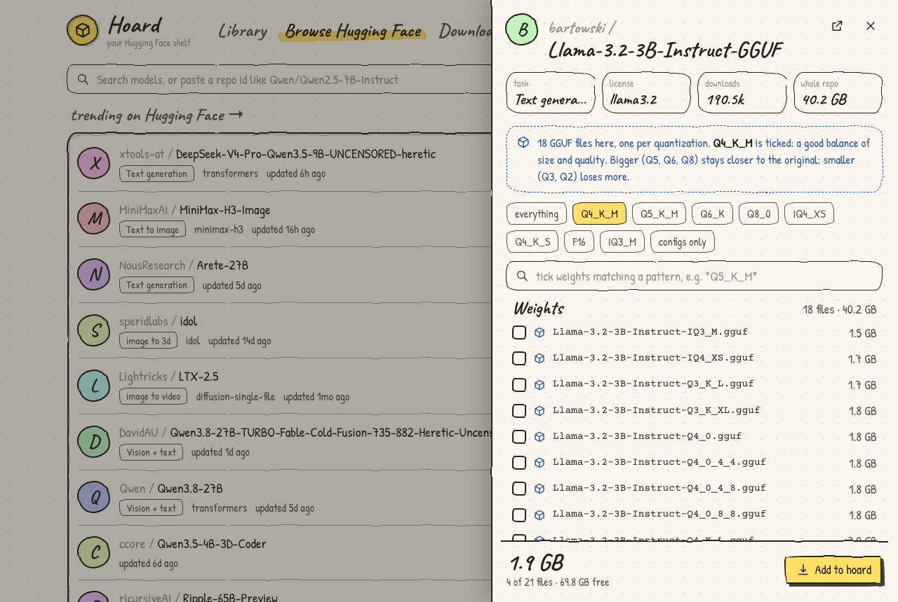
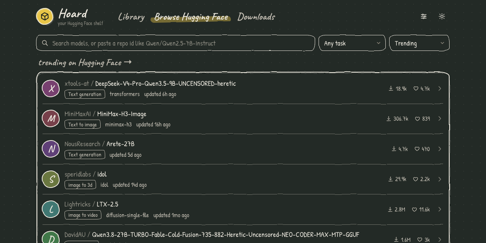
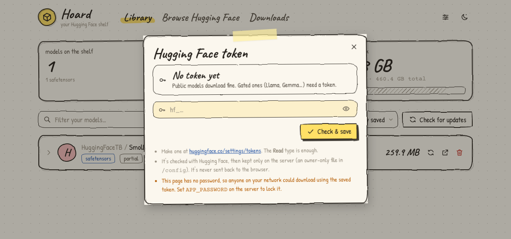

# Hoard

**A hand-drawn, self-hosted shelf for your Hugging Face models.**

Hoard runs in Docker on your home server or NAS. You search Hugging Face, pick exactly the files you want, and Hoard saves them as plain folders on your disk. Later you can use them with any tool (transformers, llama.cpp, Ollama, LM Studio...) even if the model disappears from the Hub or you're offline.


---

## Contents

- [Why Hoard](#why-hoard)
- [Features](#features)
- [Quick start](#quick-start)
- [Configuration](#configuration)
- [Using Hoard](#using-hoard)
- [Where your models end up](#where-your-models-end-up)
- [Using saved models later](#using-saved-models-later)
- [Security](#security)
- [Updating, backups and uninstalling](#updating-backups-and-uninstalling)
- [Troubleshooting](#troubleshooting)
- [Development](#development)
- [Project layout](#project-layout)
- [Credits](#credits)
- [License](#license)

More detail: [API reference](docs/API.md) · [How it works](docs/ARCHITECTURE.md)

---

## Why Hoard

The `hf` command line tool already downloads models. Hoard adds what's missing when you want to **keep** models over time:

- **A page you can open from any device** on your network, phone included. You don't need SSH.
- **File picking.** A GGUF repo can hold 40 GB of quantizations when you want one 2 GB file. Hoard preselects a sensible one and shows the total before you download.
- **A library**: what you have, how big it is, which revision, and whether Hugging Face has a newer version.
- **Plain files.** Models are saved as normal folders, not a hash-named cache, so other tools can use them directly.

## Features

| | |
|---|---|
| **Browse** | Trending, most downloaded, most liked or recently updated models, filtered by task (text generation, speech recognition, embeddings...). Paste an exact repo id to open any model, including private ones. |
| **Pick files** | Weights and configs are listed separately. One-click choices: *everything*, *safetensors + configs*, a single GGUF quantization (Q4_K_M is preselected), *configs only*, or a pattern like `*Q5_K_M*`. When a repo has the same weights in several formats, only safetensors is selected by default. Downloads that won't fit on the disk are blocked. |
| **Downloads** | Live progress with speed and time left. Stop a download at any time. **Resume** continues where it stopped. Several downloads can run at once. |
| **Library** | Size, formats, task, license, revision and save date for every model. Browse the files, check one or all models for updates, update in one click, delete with confirmation. Folders you copy in by hand also show up. |
| **Disk overview** | Model count, space used by models, and free space, with a bar that separates model data from everything else on the disk. |
| **Tokens** | Add a Hugging Face token from the UI (checked with Hugging Face, write-only, stored privately on the server) or with an environment variable. |
| **Looks** | Hand-drawn design: dotted paper in light mode, chalkboard in dark mode, pencil-stroke borders, handwriting fonts, sticky-note messages. Works on phones. Fonts are bundled, so nothing loads from the internet except Hugging Face itself. |

<p>
  
  
</p>

## Quick start

You need a Linux machine (NAS, home server, any box) with **Docker** and **Docker Compose**.

```bash
# 1. Get the code onto the server
git clone https://github.com/Mr-Sunglasses/hoard.git
cd hoard

# 2. Create the models folder (owned by you) and a private settings folder
sudo mkdir -p /srv/models && sudo chown $(id -u):$(id -g) /srv/models
mkdir -p config && chmod 700 config

# 3. Settings
cp .env.example .env
#    - set PUID / PGID to the output of `id -u` and `id -g`
#    - set APP_PASSWORD (recommended, see Security)

# 4. Start
docker compose up -d --build
```

Open **`http://<server-ip>:8080`**. If you set `APP_PASSWORD`, your browser asks for a login: any username works with that password.

> Storing models somewhere other than `/srv/models`? Change the left side of the first `volumes:` entry in `docker-compose.yml`.

## Configuration

Set these in `.env` (next to `docker-compose.yml`).

| Variable | Default | What it does |
|---|---|---|
| `APP_PASSWORD` | *(empty)* | Password for the web UI (HTTP Basic auth, any username). Empty means no login. |
| `HF_TOKEN` | *(empty)* | Hugging Face token for gated or private models. Optional: you can add one in the UI instead. When set, it **takes priority** over a token saved in the UI, and the UI shows it read-only. |
| `PUID` / `PGID` | `1000` | User and group the container runs as, so downloaded files belong to you and not to root. |

Volumes and ports (in `docker-compose.yml`):

| Container path | Default host path | Purpose |
|---|---|---|
| `/models` | `/srv/models` | Where models are saved. Can be a share or an external drive. |
| `/config` | `./config` | App settings: the token saved from the UI. **Keep this out of any shared folder.** |
| port `8080` | `8080` | Web UI. Change the left side (`"9000:8080"`) to use another port. |

Advanced variables (already set in the image, rarely changed): `MODELS_DIR=/models`, `CONFIG_DIR=/config`, and `HF_HOME=/models/.hf-home` (Hugging Face library cache, hidden from the library view).

## Using Hoard

### Find a model

Open **Browse Hugging Face**. Trending models load right away. Type to search (results update as you type), or filter by task and change the sort order. To open a specific repo, paste its id, e.g. `Qwen/Qwen2.5-7B-Instruct`. Models you already have are tagged *on your shelf*.



### Choose files and download

Click a model to open its panel. Its files are split into **Weights** and **Configs & the rest**:

- **GGUF repos** (one file per quantization): only **Q4_K_M** is selected, a good balance of size and quality. Click another quantization to switch. Bigger (Q5, Q6, Q8) stays closer to the original model; smaller (Q3, Q2) loses more quality.
- **Repos with several weight formats** (e.g. `.safetensors` + `.bin`): only safetensors is selected.
- **Pattern box**: type `*Q5_K_M*` (or any `*` pattern) to select matching weight files. Config files stay selected.

The footer shows the total size and free space. Click **Add to hoard**. If you download a model you already have, only missing files are added; existing files are kept.

### Watch downloads

**Downloads** shows each job with a progress bar, speed and time left. The red-circled number on the tab is how many are running.

- **Stop** cancels a download. Partly downloaded files are kept.
- **Resume** starts it again and continues from where it stopped.
- **Clear finished** tidies the list. The list lives in memory and empties when the container restarts. Your models are not affected.

> Progress moves in steps of tens of MB rather than smoothly. That's how Hugging Face's download library writes to disk, not a stall.

### Manage the library

**Library** lists everything in the models folder:

- Click a row to see its files and full path on disk.
- ↻ checks that model for a newer revision on Hugging Face. **Check for updates** checks all of them. When one is available, **Update** downloads the new revision with the same file selection.
- 🗑 deletes the model folder from disk after you confirm.
- Filter by name, filter by format (safetensors, gguf...), or sort by date, name or size.
- Tags: *partial* means only some of the repo's files were saved. *added by hand* means the folder wasn't downloaded through Hoard, so update checks aren't available for it.

### Add a Hugging Face token

You only need a token for **gated** models (Llama, Gemma, some Mistral releases...) and **private** repos.

1. On the model's Hugging Face page, accept its terms (click "Agree"/"Request access").
2. Create a token at <https://huggingface.co/settings/tokens>. The **Read** type is enough.
3. In Hoard, click the **sliders icon** (top right), paste the token and click **Check & save**.



Hoard checks the token with Hugging Face, then shows which account it belongs to and its last four characters. It suggests a Read token if yours has more access than Hoard needs. To use an environment variable instead, set `HF_TOKEN` in `.env` and restart.

### Handy details

- Press `/` to jump to the search or filter box. `Esc` closes panels and dialogs.
- The sun/moon icon switches between paper and chalkboard. Hoard follows your system setting until you choose.
- The URL remembers the tab (`#library`, `#browse`, `#downloads`), so you can bookmark one.

## Where your models end up

Each repo gets one folder, named `<org>__<model>`:

```
/srv/models/
├── HuggingFaceTB__SmolLM2-135M-Instruct/
│   ├── config.json
│   ├── model.safetensors
│   ├── tokenizer.json
│   ├── ...
│   ├── .hoard.json          ← Hoard's notes: repo id, revision, file selection, license
│   └── .cache/              ← Hugging Face download state (lets downloads resume)
├── bartowski__Llama-3.2-3B-Instruct-GGUF/
│   └── Llama-3.2-3B-Instruct-Q4_K_M.gguf
└── .hf-home/                ← Hugging Face library cache (hidden from the UI)
```

The files keep the repo's own layout and names. Deleting `.hoard.json` doesn't delete the model: Hoard then lists it as *added by hand*.

## Using saved models later

Point your tools at the folder instead of the repo id.

**transformers**
```python
from transformers import AutoModelForCausalLM, AutoTokenizer
path = "/srv/models/HuggingFaceTB__SmolLM2-135M-Instruct"
tok = AutoTokenizer.from_pretrained(path)
model = AutoModelForCausalLM.from_pretrained(path)
```

**llama.cpp**
```bash
llama-cli -m /srv/models/bartowski__Llama-3.2-3B-Instruct-GGUF/Llama-3.2-3B-Instruct-Q4_K_M.gguf -p "Hello"
```

**Ollama** (GGUF files)
```bash
echo 'FROM /srv/models/bartowski__Llama-3.2-3B-Instruct-GGUF/Llama-3.2-3B-Instruct-Q4_K_M.gguf' > Modelfile
ollama create llama3.2-3b -f Modelfile
```

**LM Studio**: copy or link the GGUF into LM Studio's models folder, or mount the NAS share and point LM Studio's *models directory* setting at it.

## Security

Hoard is built for a **home network**. What it does to protect you:

- **Optional password.** Set `APP_PASSWORD` to require a login for the whole UI and API. *Strongly recommended* once you save a token: without one, anyone on your network can download using it. Hoard's settings dialog warns you when no password is set.
- **Write-only token.** A token saved from the UI is checked with Hugging Face, then written to `/config/hf_token` with owner-only permissions (`0600`), outside the models share. The API never returns it, only the account name and last four characters.
- **Cross-site protection.** Every request that changes something must carry an `X-Requested-With: hoard` header. Other websites can't send that header from your browser, so a page you visit can't delete models or replace your token.
- **No path tricks.** Model folder names are checked so requests can't reach outside the models folder.
- **No telemetry.** Hugging Face telemetry is turned off, and the UI loads nothing from the internet. Fonts are bundled.
- **Runs as your user, not root** (`PUID`/`PGID`).

What it doesn't do: HTTPS, user accounts, or rate limiting. **Don't expose port 8080 to the internet.** For remote access use a VPN (Tailscale, WireGuard), or put it behind a reverse proxy with HTTPS and its own authentication.

## Updating, backups and uninstalling

- **Update Hoard:** replace the project files with the new version, then run `docker compose up -d --build`. Models and settings live in the volumes and are kept.
- **Back up:** the models folder holds the models and their `.hoard.json` notes. `config/` holds the saved token. You can always re-create the token instead of backing it up.
- **Uninstall:** `docker compose down`, then delete the project folder. Your models stay in the models folder until you delete them.

## Troubleshooting

| Problem | Fix |
|---|---|
| `Permission denied` or the container keeps restarting | The models or config folder isn't writable by `PUID:PGID`. Run `sudo chown -R $(id -u):$(id -g) /srv/models config`. Docker creates missing host folders as root, so create them before the first start. |
| *"This model is gated"* | Accept the terms on the model's Hugging Face page, then add a token (Settings). Access approval can take a while for some models. |
| *"Model not found"* | Check the repo id spelling. For private repos, the token's account needs access. |
| *"Could not save the token in /config"* | The `config/` folder isn't writable by the container user. See the first row. |
| Token settings are read-only | `HF_TOKEN` is set in `.env`. Remove it and restart to manage the token from the UI. |
| Download *"failed"* | Hover over the error for details, then click **Resume**. Common causes: a network drop, a full disk, or a gated model without access. |
| Progress jumps instead of moving smoothly | Expected. Data is written to disk in chunks. |
| Downloads list empty after restart | Expected. Only the list resets; finished models are in the Library. |
| UI looks unstyled or old after an update | Hard-refresh the page (Ctrl/Cmd + Shift + R). |

Logs: `docker compose logs -f hoard`.

## Development

Requirements: Python 3.11+.

```bash
python3 -m venv .venv && source .venv/bin/activate
pip install -r requirements.txt
mkdir -p models config
MODELS_DIR=$PWD/models CONFIG_DIR=$PWD/config HF_HOME=$PWD/models/.hf-home \
  uvicorn app.main:app --reload --port 8080
```

There's no frontend build step: the UI is a single HTML file with plain JavaScript. Edit `app/static/index.html` and reload the page. Read [How it works](docs/ARCHITECTURE.md) before changing download or token code.

## Project layout

```
hoard/
├── app/
│   ├── main.py              ← FastAPI backend: Hub search, downloads, library, token settings
│   └── static/
│       ├── index.html       ← the whole UI (HTML + CSS + JS, hand-drawn theme, icons)
│       └── fonts/           ← bundled Caveat, Patrick Hand, Courier Prime (+ their OFL licenses)
├── docs/
│   ├── API.md               ← HTTP API reference
│   ├── ARCHITECTURE.md      ← how downloads, progress, metadata and security work
│   └── images/              ← screenshots
├── Dockerfile
├── docker-compose.yml
├── requirements.txt
├── .env.example
└── LICENSE
```

## Credits

- Built on [FastAPI](https://fastapi.tiangolo.com/) and [`huggingface_hub`](https://github.com/huggingface/huggingface_hub).
- Fonts: [Caveat](https://fonts.google.com/specimen/Caveat), [Patrick Hand](https://fonts.google.com/specimen/Patrick+Hand) and [Courier Prime](https://fonts.google.com/specimen/Courier+Prime), all under the SIL Open Font License 1.1 (license texts in [`app/static/fonts/`](app/static/fonts)).
- Hoard isn't affiliated with Hugging Face. Each model's license is set by its authors and shown in the app. Check it before you use a model.

## License

Hoard is released under the [MIT License](LICENSE).
