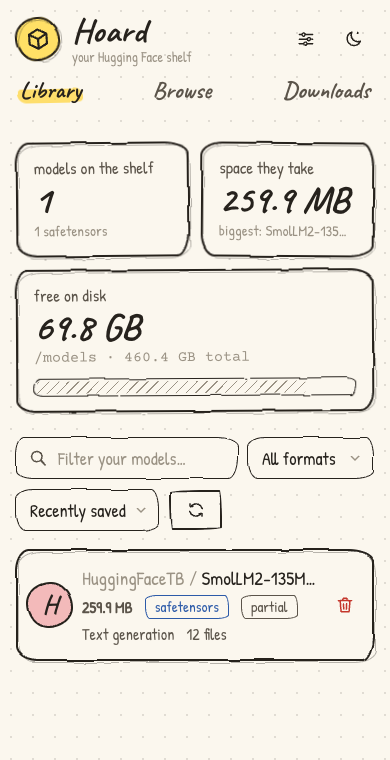

# Hoard

[](https://github.com/Mr-Sunglasses/hoard/actions/workflows/ci.yml)
[](https://github.com/Mr-Sunglasses/hoard/releases)
[](LICENSE)

**A hand-drawn, self-hosted shelf for your Hugging Face models.**

Hoard runs in Docker on your home server or NAS. Search Hugging Face, pick exactly the files you want, and Hoard saves them as plain folders on your disk, ready for transformers, llama.cpp, Ollama or LM Studio, even offline or after a model disappears from the Hub.


- **Pick only the files you need.** A GGUF repo can hold 40 GB of quantizations when you want one 2 GB file. Hoard preselects a sensible one (Q4_K_M) and shows the total before you download.
- **Keep track of it all.** Size, format, license and revision of every model, update checks, and free disk space.
- **Use it from any device.** It's a web page, so it works from a phone, with no SSH needed.
- **Plain files.** Normal folders with the repo's own file names, not a hash-named cache.

<p>
  
  
</p>

## Quick start

You need a Linux machine with Docker and Docker Compose.

```bash
git clone https://github.com/Mr-Sunglasses/hoard.git && cd hoard

sudo mkdir -p /srv/models && sudo chown $(id -u):$(id -g) /srv/models
mkdir -p config && chmod 700 config

cp .env.example .env    # set PUID/PGID (`id -u`, `id -g`) and APP_PASSWORD
docker compose up -d --build
```

Open `http://<server-ip>:8080`. With `APP_PASSWORD` set, log in with any username and that password.

Prefer not to build? Every release is published as `ghcr.io/mr-sunglasses/hoard` for amd64 and arm64: swap `build: .` for the `image:` line in `docker-compose.yml`. The [deployment guide](docs/DEPLOYMENT.md) covers that, reverse proxies, updates, backups and monitoring.

## Configuration

All settings go in `.env`. Only `PUID`/`PGID` are required.

| Setting | Default | What it does |
|---|---|---|
| `PUID` / `PGID` | `1000` | The user the container runs as, so files belong to you, not root. |
| `APP_PASSWORD` | empty (no login) | Password for the UI and API. Recommended. |
| `HF_TOKEN` | empty | Hugging Face token for gated or private models. You can also add one in the UI; this one wins if both are set. |
| `ALLOWED_HOSTS` | empty | Extra host names you open Hoard by, like `hoard.example.com` behind a reverse proxy. IPs and local names (`nas`, `nas.local`) always work. |
| `TRUSTED_PROXIES` | empty | Your reverse proxy's address as Hoard sees it (an IP or network like `172.16.0.0/12`), so wrong passwords lock out one visitor instead of everyone. See [Security](#security). |
| `BIND_ADDRESS` / `PORT` | `0.0.0.0` / `8080` | Where Hoard listens. See [Security](#security). |
| `MAX_PARALLEL_DOWNLOADS` | `2` | Downloads that run at once; the rest wait in a queue. |
| `MIN_FREE_GB` | `2` | Space always kept free on the models disk. Downloads that would use it are refused. |

Models are saved to `/srv/models`; change the first `volumes:` entry in `docker-compose.yml` to use another folder. `./config` holds the saved token and the download list, so keep it out of any shared folder.

## Using Hoard

**Browse.** Trending models load right away. Search, filter by task, or paste a repo id like `Qwen/Qwen2.5-7B-Instruct`. Models you already have are tagged *on your shelf*.

**Pick files.** Click a model to see its weights and configs. Choose a preset (everything, safetensors + configs, one GGUF quantization, configs only) or type a pattern like `*Q5_K_M*`. The footer shows the total size and the free space on disk.

**Download.** The Downloads tab shows progress, speed and time left. Two downloads run at a time and the rest wait their turn. If the connection drops, Hoard retries by itself (after 15 s, 1 min and 5 min). After a restart or power cut, unfinished downloads continue on their own. **Stop** and **Resume** keep every finished file, but a file that was partly downloaded starts over.

**Library.** Click a row to see its files. ↻ checks for a newer revision, and **Update** fetches it with the same file selection. **Check files** compares every file with Hugging Face's hashes, and offers to download any damaged or missing ones again. A model whose download didn't finish is tagged *unfinished*, with a **Resume** button. Folders you copy in by hand show up too, tagged *added by hand*.

**Pickle warnings.** `.bin`, `.pt` and `.pth` files use Python pickle, which can run code when loaded with `torch.load()`. Hoard tags them, warns before downloading them, and shows the results of Hugging Face's security scan. Prefer safetensors when a repo offers both.

**Gated models** (Llama, Gemma…) need a token:

1. Accept the model's terms on its Hugging Face page.
2. Create a **Read** token at <https://huggingface.co/settings/tokens>.
3. In Hoard, open settings (the sliders icon, top right), paste the token and click **Check & save**.

Press `/` to jump to the search box and `Esc` to close panels. The sun/moon icon switches between the paper and chalkboard themes.

## Your files

Each repo gets one folder named `<org>__<model>`:

```
/srv/models/
├── bartowski__Llama-3.2-3B-Instruct-GGUF/
│   ├── Llama-3.2-3B-Instruct-Q4_K_M.gguf
│   ├── .hoard.json      ← Hoard's notes: repo, commit, file selection
│   └── .cache/          ← resume data
└── HuggingFaceTB__SmolLM2-135M-Instruct/
    ├── config.json
    └── model.safetensors
```

Point your tools at the folder instead of the repo id:

```python
model = AutoModelForCausalLM.from_pretrained("/srv/models/HuggingFaceTB__SmolLM2-135M-Instruct")
```

```bash
# llama.cpp
llama-cli -m /srv/models/bartowski__Llama-3.2-3B-Instruct-GGUF/Llama-3.2-3B-Instruct-Q4_K_M.gguf

# Ollama
echo 'FROM /srv/models/bartowski__Llama-3.2-3B-Instruct-GGUF/Llama-3.2-3B-Instruct-Q4_K_M.gguf' > Modelfile
ollama create llama3.2-3b -f Modelfile
```

## Security

Hoard is made for a home network.

- **Set `APP_PASSWORD`.** Without it, anyone on your network can use Hoard and your saved token, and the UI shows a warning until you set one. After 10 wrong passwords, an address is locked out for 15 minutes.
- **Don't expose it to the internet.** Hoard has no HTTPS, so the password travels in plain text. For remote access use a VPN (Tailscale, WireGuard), or a reverse proxy with HTTPS:

  ```
  # Caddyfile (add hoard.example.com to ALLOWED_HOSTS, and BIND_ADDRESS=127.0.0.1)
  hoard.example.com {
      reverse_proxy 127.0.0.1:8080
  }
  ```
- **Behind a reverse proxy,** every request reaches Hoard from the proxy, so ten wrong passwords from anyone would lock everybody out. Set `TRUSTED_PROXIES` to the proxy's address, and Hoard reads each visitor's own address from `X-Forwarded-For`. For a proxy on the Docker host, that's the Docker network's gateway: `docker network inspect hoard_default -f '{{range .IPAM.Config}}{{.Gateway}}{{end}}'`, or `172.16.0.0/12` to cover any Docker network. Never list addresses that other machines can connect from.
- **Firewalls:** on Ubuntu, Docker's published ports skip `ufw` rules. To limit who can connect, set `BIND_ADDRESS` to the server's LAN IP, or to `127.0.0.1` behind a reverse proxy.

What Hoard does on its own:

- A token saved in the UI is checked with Hugging Face, stored owner-only on the server, and never sent back to the browser.
- Other websites can't use Hoard through your browser. Changes need a header they can't send, and Hoard only answers to its own host names, which blocks DNS rebinding.
- A strict Content Security Policy stops other sites from embedding the page and blocks injected scripts. Nothing loads from the internet except Hugging Face itself.
- The container runs as your user with a read-only filesystem and no Linux capabilities.

[How it works](docs/ARCHITECTURE.md#request-protection) has the details.

## Maintenance

- **Update:** `git pull && docker compose up -d --build` (or `docker compose pull && docker compose up -d` with the published image). Models, settings and unfinished downloads are kept; running downloads stop cleanly and continue after the restart. See [CHANGELOG.md](CHANGELOG.md) for what changed.
- **Back up:** the models folder. `config/` only holds the token (easy to create again) and the download list.
- **Uninstall:** `docker compose down` and delete the project folder. Your models stay where they are.
- **Logs:** `docker compose logs -f hoard`

## Troubleshooting

| Problem | Fix |
|---|---|
| `Permission denied`, or the container keeps restarting | `sudo chown -R $(id -u):$(id -g) /srv/models config`. Create both folders before the first start, or Docker makes them owned by root. |
| *"This model is gated"* | Accept the terms on Hugging Face and add a token. Some models need manual approval first. |
| *"Model not found"* | Check the spelling. For private repos, the token's account needs access. |
| *"Hoard doesn't answer to this host name"* | You opened Hoard by a domain name. Add it to `ALLOWED_HOSTS`. |
| *"Too many wrong passwords"* | Wait 15 minutes, or restart the container. If it happens to everyone at once behind a reverse proxy, set `TRUSTED_PROXIES`. |
| *"Not enough space"* | Free some space, or lower `MIN_FREE_GB`. |
| Token settings are read-only | `HF_TOKEN` is set in `.env`. Remove it and restart to manage the token in the UI. |
| A download failed | Hover the error for details, then **Resume**. Network errors are retried by themselves first. |
| The page looks broken after an update | Hard-refresh (Ctrl/Cmd + Shift + R). |

## Documentation

- [Deployment](docs/DEPLOYMENT.md): published images, reverse proxies (Caddy, nginx, Traefik), updates and rollbacks, backups, monitoring, every setting
- [How it works](docs/ARCHITECTURE.md): code layout, downloads, security, the hand-drawn look, and running it locally
- [API reference](docs/API.md): use Hoard from scripts
- [Security policy](SECURITY.md): what Hoard protects against, and how to report a vulnerability
- [Contributing](CONTRIBUTING.md): development setup, checks, style, and releasing
- [Changelog](CHANGELOG.md)

## Credits

Built on [FastAPI](https://fastapi.tiangolo.com/) and [`huggingface_hub`](https://github.com/huggingface/huggingface_hub). Fonts: [Caveat](https://fonts.google.com/specimen/Caveat), [Patrick Hand](https://fonts.google.com/specimen/Patrick+Hand) and [Courier Prime](https://fonts.google.com/specimen/Courier+Prime) (SIL Open Font License, texts in [`app/static/fonts/`](app/static/fonts)).

Hoard isn't affiliated with Hugging Face. Each model's license is set by its authors and shown in the app. Check it before you use a model.

## License

[MIT](LICENSE)
